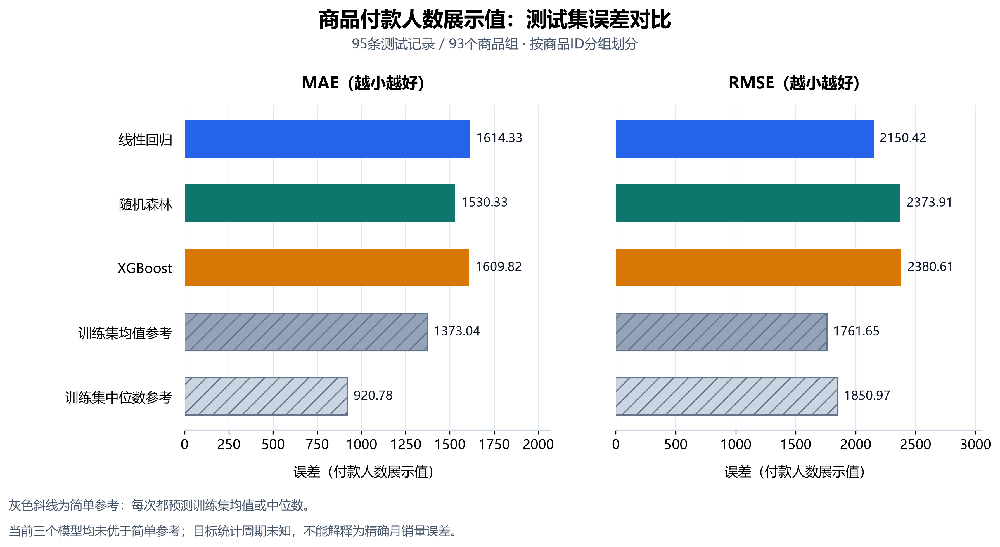
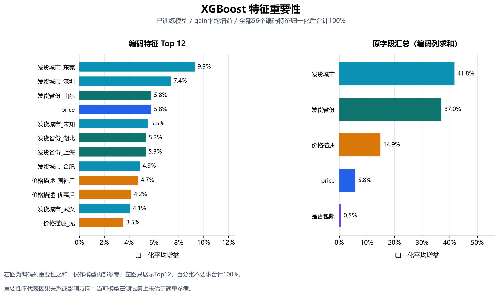

# 电商商品销量预测

> 付款人数展示值回归练习｜Python 3.12｜CPU 运行｜线性回归、随机森林、XGBoost

## 项目简介

使用商品价格、是否包邮、发货省份、发货城市和价格描述，预测商品页面的付款人数展示值，对比三个回归模型，完成数据探索、清洗、分组划分、特征编码、训练、评估和可视化。

**本版目标是 `payment_display`（付款人数展示值）。数据统计周期尚未确认，带“+”的展示值是近似下界，当前实验属于静态数据回归练习，不提供未来月份预测结论。**

本次实验的三个模型均未超过简单常数参考。项目保留这一真实结果，用于学习完整实验流程和分析方法。

## 1. 数据来源与实际字段

- 来源记录：[阿里天池数据集 234704](https://tianchi.aliyun.com/dataset/234704)。
- 原始文件：`data/data.xlsx`，工作表：`data`，24,037 行、24 列。
- 原表采集时间范围：2026-10-27 19:09:38 至 22:19:08。采集时间不等于销量统计周期。
- 数据的统计口径和再分发许可仍待核实。公开仓库提交原始数据前应核对来源许可；未确认时由使用者自行从来源下载。

实际数据没有原方案假定的好评率、上架天数和是否促销字段，因此本版按真实字段建模。清洗后样本全部属于“电脑”类目，类目没有变化，未作为输入。

| 原始字段 | 建模字段或用途 | 处理方式 |
|---|---|---|
| 价格（元） | `price`，数值输入 | 转为数值；保留正价格 |
| 是否包邮 | 0/1 输入 | 包邮=1，不包邮=0 |
| 发货省份 | 类别输入 | 缺失填“未知”，独热编码 |
| 发货城市 | 类别输入 | 缺失填“未知”，独热编码 |
| 价格描述 | 类别输入 | 缺失填“未知”，独热编码 |
| 销量（件） | `payment_display`，目标值 | 仅解析“人付款”文本，按“万”换算 |
| 商品ID | 分组依据 | 同一商品的记录必须进入同一组 |

店铺标签、榜单、摘要、销量原文、加号标记和商品ID均未作为预测特征。

### 目标值解析示例

| 原始文本 | `payment_display` | `payment_has_plus` |
|---|---:|---|
| 1人付款 | 1 | `False` |
| 3000+人付款 | 3000 | `True` |
| 1万+人付款 | 10000 | `True` |
| 0人付款 | 0 | `False` |

“1万+人付款”记录为展示下界 10,000，不表示精确值；“人看过”表示浏览人数，已从本任务中排除。

## 2. 数据清洗与特征准备

1. 读取 Excel，查看字段、缺失比例、价格分布和类目数量。
2. 将价格转为数字，筛选正价格且付款人数格式可识别的记录。
3. 标记带“+”的付款人数和重复商品ID，保留真实的零付款记录。
4. 按商品ID划分训练集、测试集后，才学习数值填充和类别编码规则。
5. 数值特征用训练集中位数填充；类别编码使用 `OneHotEncoder(handle_unknown="ignore")`。

| 数据检查项 | 数量 |
|---|---:|
| 原始记录 | 24,037 |
| 同时有价格和销量文本的记录 | 499 |
| 排除“人看过”的记录 | 13 |
| 清洗后建模记录 | 486 |
| 不同商品ID | 464 |
| 带“+”的付款人数记录 | 344 |
| 付款人数展示值为0的记录 | 35 |

清洗结果保存为 `data/sales_cleaned.csv`，共 486 行、28 列。价格极端值未按测试结果删除，原始目标值也未进行截断或对数变换。

## 3. 数据划分与训练方法

使用 `GroupShuffleSplit(n_splits=1, test_size=0.2, random_state=42)`，以商品ID为组。

| 数据集 | 记录数 | 不同商品数 | 记录占比 | 编码后特征数 |
|---|---:|---:|---:|---:|
| 训练集 | 391 | 371 | 80.45% | 56 |
| 测试集 | 95 | 93 | 19.55% | 56 |

两组重复商品数为 **0**。`test_size=0.2` 控制商品组比例，因此记录比例不一定恰好是 20%。

- 训练特征：`X_train_encoded`；训练目标：`y_train`。
- 测试特征：`X_test_encoded`；测试目标：`y_test`。
- 正式预处理器只在训练集上 `fit_transform`，测试集仅 `transform`。前5行编码演示使用独立副本，不参与正式处理。
- 三个模型使用相同的训练集和测试集。当前没有进行调参或交叉验证。

### 模型与主要参数

| 模型 | 本次配置 |
|---|---|
| 线性回归 | `LinearRegression()`，使用默认参数 |
| 随机森林 | `n_estimators=200`，`max_depth=8`，`min_samples_leaf=2`，`random_state=42`，`n_jobs=2` |
| XGBoost | `objective="reg:squarederror"`，`n_estimators=200`，`max_depth=3`，`learning_rate=0.05`，`subsample=0.8`，`colsample_bytree=0.8`，`tree_method="hist"`，`device="cpu"`，`random_state=42`，`n_jobs=2` |

训练后的模型位于当前 Jupyter 内核的 `models` 字典中。本项目尚未导出模型文件；重启内核后需要重新按顺序运行 Notebook。

## 4. 测试集结果

MAE（平均绝对误差）表示每条记录的平均绝对预测误差；RMSE（均方根误差）对较大的预测误差惩罚更强。两项都越小越好，单位与付款人数展示值一致。

以下结果来自固定的 95 条测试记录。采用模型原始预测值，没有将负预测截断为0。

| 模型或参考 | MAE | RMSE | 负预测条数 |
|---|---:|---:|---:|
| 线性回归 | 1614.33 | 2150.42 | 9 |
| 随机森林 | 1530.33 | 2373.91 | 0 |
| XGBoost | 1609.82 | 2380.61 | 4 |
| 始终预测训练集均值 | 1373.04 | 1761.65 | 0 |
| 始终预测训练集中位数 | 920.78 | 1850.97 | 0 |

两个参考常数只由训练集计算：均值约 1509.57，中位数为 300。指标CSV保存了完整精度，README仅保留两位小数。

### 如何解释结果

- 三个回归模型中，随机森林的 MAE 最低，线性回归的 RMSE 最低。
- 三个模型的两项误差都高于简单常数参考，本次实验尚未展示出相对参考的预测改进。
- XGBoost 并不保证在所有数据上最好，本次不能写成“XGBoost效果最佳”。
- 这些指标来自一次小样本分组测试，不代表稳定的未来业务效果。后续改进应在训练集内部做分组交叉验证；当前测试集已查看，继续改进后的最终评估宜另留新数据。

### MAE、RMSE 对比图

彩色柱表示三个回归模型，灰色斜线柱表示简单参考；横轴从0开始。



## 5. XGBoost 特征重要性

从已经训练的模型提取 [gain（平均增益）](https://xgboost.readthedocs.io/en/stable/python/python_api.html#xgboost.Booster.get_score)，将全部56个编码特征的数值归一化。左图展示前12个编码特征，右图将同一原始字段下的编码列重要性相加。



| 原始字段 | 编码列重要性合计 |
|---|---:|
| 发货城市 | 41.77% |
| 发货省份 | 37.03% |
| 价格描述 | 14.91% |
| 价格（price） | 5.77% |
| 是否包邮 | 0.52% |

该表是当前模型内部重要性的汇总，不表示业务因果关系、影响方向或价格弹性。不同字段包含的编码列数量不同，汇总仅供参考；当前模型的测试误差也未超过简单参考。左图只展示Top12，其百分比无需合计100%。

## 6. 项目目录

```text
sales-prediction-demo/
├── README.md
├── requirements.txt                 # 本次运行验证的依赖版本
├── .gitignore                       # 排除数据、环境、密钥和缓存
├── .gitattributes                   # 文本换行与图片类型约定
├── GITHUB_UPLOAD.md                 # 发布副本与网页上传说明
├── main.ipynb                       # 主实验，17个代码单元格
├── data/
│   └── README.md                    # 数据获取与许可说明
├── img/
│   ├── model_comparison.png         # MAE、RMSE对比图，300 DPI
│   └── feature_importance.png       # XGBoost重要性图，300 DPI
└── results/
    ├── model_metrics.csv            # 三个模型的指标及负预测数量
    ├── baseline_metrics.csv         # 两个常数参考的指标
    ├── xgboost_feature_importance.csv  # 56个编码特征的重要性
    └── xgboost_grouped_importance.csv  # 5个原始字段的汇总
```

## 7. 如何运行

本发布包保留代码、汇总指标和图表。原始工作簿及逐条数据不随包提供，运行前先按 [data/README.md](data/README.md) 获取数据，将其放入 `data/data.xlsx`，工作表名为 `data`。

在解压后的项目根目录打开 Windows PowerShell，执行：

```powershell
py -3.12 -m venv .venv
.\.venv\Scripts\python.exe -m pip install -r requirements.txt
.\.venv\Scripts\python.exe -m notebook
```

1. 在Jupyter中打开 `main.ipynb`，选择新环境的Python内核。
2. 点击 **Run → Run All Cells**，从上到下执行全部17个代码单元格。
3. 核对清洗486条、训练391条、测试95条、编码56列，查看指标和最后两张图。
4. 按 **Ctrl+S** 保存。模型在当前内核内存中，重启后需要重新运行。

`openpyxl`用于读取Excel；中文图表需要本机可用的 Microsoft YaHei、SimHei 等中文字体。本次验证环境为Windows、Python 3.12.10、CPU，依赖版本见 `requirements.txt`。其他系统和新环境安装尚未单独验证。

运行后会在本地生成清洗数据和逐条测试预测；这些文件已通过 `.gitignore` 排除。发布Notebook的输出和执行编号为空，README和汇总图片展示的是本次真实数据实验结果。

## 8. 局限与改进方向

1. **确认目标口径**：核实付款人数的统计周期和“+”的含义；未来月销量预测需要带时间和明确月份的真实标签。
2. **补充有效数据**：原始表中大部分记录缺少价格或销量文本，当前只使用486条电脑商品记录，不能代表全部电商类目。
3. **完善输入特征**：在明确预测时点后，增加商品规格、品牌及预测时点前的行为信息，审查字段是否包含未来或目标信息。
4. **处理长尾与负预测**：可在训练集内部比较目标对数变换、适合非负目标的方案；反变换和评估口径需记录清楚。
5. **分组验证与调参**：训练集内部使用按商品ID分组的交叉验证，再考虑随机森林、XGBoost参数搜索，避免依据当前测试集反复修改模型。
6. **扩展工程能力**：后续可将预处理器与模型组合、保存模型，并在新的独立数据上完成最终验证。

本版已完成数据探索、清洗、分组划分、编码、三模型训练、测试评估、结果导出、绘图与项目说明。上述改进尚未实施，当前结果定位为入门学习实验。

## 9. GitHub 发布

依赖版本已记录在 `requirements.txt`，数据获取方式见 `data/README.md`，发布与上传步骤见 [GITHUB_UPLOAD.md](GITHUB_UPLOAD.md)。

本发布副本已清除 Notebook 输出、执行编号及运行时元数据，未包含原始数据、逐条清洗数据、逐条预测、检查点和环境目录；保留汇总指标和图表。上传步骤见 GITHUB_UPLOAD.md。

源码许可证尚未指定；本次只做检查和打包，没有创建远程仓库或上传文件。
